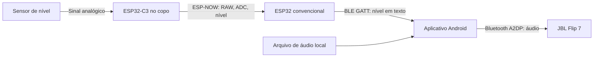

# Arquitetura 1
### Arquitetura que bota o celular como receptor de informações do esp32 convencional e envia para a caixa os valores das porcentagens após a conversão dos valores recebidos pelo sensor de volume d'água. É a arquitetura que seguirá com o projeto
